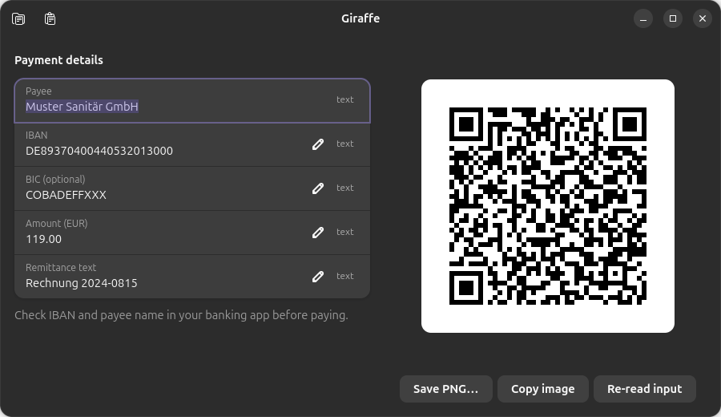

<p align="center">
  
</p>

# Giraffe

Turn an invoice into a **GiroCode**: Giraffe reads the payment details from a PDF (or from
copied text) and shows an EPC QR code. Scan it with your banking app and the SEPA transfer
is prefilled. Everything runs locally: no network access, no cloud, no telemetry, and
no invoice data is stored.



*(Example data. The IBAN is a public test IBAN.)*

## Requirements

Linux with GNOME on Wayland (developed on Ubuntu 26.04).

```
sudo apt install python3-gi gir1.2-gtk-4.0 gir1.2-adw-1 poppler-utils python3-venv
```

`wl-clipboard` is optional and only used as a clipboard fallback.

## Install

```
git clone https://github.com/cbandera/giraffe.git
cd giraffe
scripts/install.sh
```

This creates a virtual environment, installs a `giraffe` launcher in `~/.local/bin`, adds
a desktop entry (Giraffe then appears in "Open with" for PDFs) and registers the keyboard
shortcut **Ctrl+Alt+G**. Pass `--no-shortcut` to skip the shortcut. Make sure
`~/.local/bin` is on your `PATH` if you want to start it from a terminal.

## Usage

1. Open an invoice in one of these ways:
   - `giraffe invoice.pdf`, or right-click a PDF → *Open with* → Giraffe
   - drag a PDF (or text) onto the window
   - **Ctrl+O** to pick a file
   - select text in a PDF viewer or mail, copy it, and press **Ctrl+Alt+G**
     (or run `giraffe --clipboard`); inside the window, **Ctrl+V** does the same
2. Check the detected payee, IBAN, BIC, amount and remittance text. Edit anything that is
   wrong; the QR code updates immediately. A small label next to each field shows where
   the value came from: `e-invoice` (structured data in the PDF, most reliable), `text`
   (guessed from the text, double-check it) or `manual` (typed by you).
3. If several IBANs or amounts were found, pick the right one from the dropdown in the field.
4. Scan the QR code with your banking app. **Always compare IBAN and payee name in the
   app before you confirm the payment.**

You can also save the QR code as a PNG or copy it as an image.

If a field is invalid, no QR code is shown; the message under the form tells you why
(for example a wrong IBAN checksum, a missing payee, or text that is too long). Without
an amount a QR code is still produced, and you enter the amount in the banking app.

For a faster hotkey, run `giraffe --background` at login to keep an invisible instance
resident. Launching Giraffe again always reuses the running instance.

## Limitations (v1)

- Only EUR payments. Invoices in another currency are rejected.
- Scanned PDFs (images without text) are not supported yet; there is no OCR.
- Payee detection from plain text is a best guess. Always check it.
- No history, no tray icon.
- Opening attachments directly from Thunderbird and drag and drop from it are untested:
  save the attachment and use *Open with* if it does not work.

## Troubleshooting

- **The hotkey does nothing:** check *Settings → Keyboard → Shortcuts → Custom* for
  "Giraffe (clipboard)" and that `~/.local/bin/giraffe` exists and is executable.
- **"The clipboard contains no text":** copy the text again; on Wayland the clipboard is only
  readable once the Giraffe window has focus. Installing `wl-clipboard` can help.
- **Payee is empty or wrong:** type it in. See [CONTRIBUTING.md](CONTRIBUTING.md) if you
  want to help improve the detection for your invoices.

## Uninstall

```
rm ~/.local/bin/giraffe \
   ~/.local/share/applications/io.github.giraffe.Giraffe.desktop \
   ~/.local/share/icons/hicolor/scalable/apps/io.github.giraffe.Giraffe.svg
```

Then remove the "Giraffe (clipboard)" entry under *Settings → Keyboard → Shortcuts → Custom*
and delete the project folder.

## Contributing

See [CONTRIBUTING.md](CONTRIBUTING.md). The product specification is in [SPEC.md](SPEC.md).
